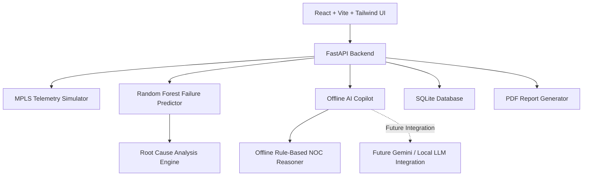

# 🚀 ISRO BAH 2026 — Air-Gapped Predictive Copilot for Secure MPLS Operations

**An AI-powered predictive network monitoring and incident management platform designed for secure, air-gapped MPLS environments.**


---

## 📌 1. Project Overview

Modern MPLS (Multiprotocol Label Switching) networks require continuous monitoring to ensure availability, reliability, and secure communication.

Traditional network monitoring systems primarily identify failures after they occur, resulting in service disruptions, delayed troubleshooting, and increased operational overhead.

**Our solution: Air-Gapped Predictive Copilot for Secure MPLS Operations** introduces an intelligent monitoring platform that predicts potential network failures before they happen.

The platform simulates MPLS router telemetry, detects abnormal network behavior, predicts failure probabilities using Machine Learning, identifies possible root causes, and recommends actionable Network Operations Center (NOC) responses.

It also provides an offline AI Copilot that allows network administrators to interact with network telemetry using natural language.

### 🎯 Key Objectives

- Predict potential router failures before service disruption.
- Detect network anomalies in real time.
- Identify probable root causes of network problems.
- Recommend preventive NOC actions.
- Provide an offline AI-assisted troubleshooting experience.
- Support secure deployment in air-gapped environments.

---

## 🏗️ 2. System Architecture

The application follows a modular full-stack architecture.



### Technology Stack

| Component | Technology |
|---|---|
| Frontend | React.js, Vite |
| UI Styling | Tailwind CSS |
| Charts | Recharts |
| Backend | Python, FastAPI |
| Machine Learning | Scikit-learn |
| Prediction Algorithm | Random Forest |
| Database | SQLite |
| AI Copilot | Offline Rule-Based Reasoning |
| Future AI Integration | Gemini API / Local LLM |
| Report Generation | PDF Generator |

---

## ⚡ 3. Core Features

### 3.1 Real-Time MPLS Network Simulation

Simulates multiple MPLS routers and continuously generates network telemetry.

Monitored parameters include:

- CPU utilization
- Memory utilization
- Router connectivity and link status
- Network latency
- Packet loss percentage
- Bandwidth utilization
- Network traffic volume
- Active alerts and incidents

### 3.2 Intelligent Network Dashboard

Provides a centralized monitoring interface with:

- Total number of routers.
- Healthy routers.
- Warning routers.
- Critical routers.
- Active network incidents.
- Live network health indicators.

### 3.3 Real-Time Telemetry Visualization

Interactive charts display network performance trends.

- CPU utilization over time.
- Network latency trends.
- Packet loss monitoring.
- Traffic and bandwidth utilization.

### 3.4 Anomaly Detection Engine

Automatically identifies abnormal network behavior, including:

| Anomaly | Description |
|---|---|
| High CPU | Unusually high router processing utilization |
| Memory Leak | Abnormal memory consumption |
| Latency Spike | Sudden increase in network delay |
| Packet Loss Surge | Increased packet transmission failures |
| Link Failure | Router interface or connectivity failure |
| Network Congestion | Excessive traffic and bandwidth utilization |

### 3.5 Predictive Failure Detection

Uses a Scikit-learn Random Forest model to estimate the probability of future router failures.

The prediction engine provides:

- Router failure risk score.
- Critical failure probability.
- Predicted outage time.
- Router health assessment.
- Preventive maintenance recommendations.

### 3.6 Root Cause Analysis

Analyzes detected anomalies and identifies probable causes behind network performance degradation.

The system correlates telemetry indicators to provide understandable troubleshooting insights.

### 3.7 Offline AI Copilot

An interactive, ChatGPT-style NOC assistant that analyzes simulated network telemetry and provides recommendations.

**Example questions:**

- Which router is most likely to fail?
- What should I do about packet loss?
- Which routers are currently critical?
- Why is network latency increasing?
- What preventive actions should the NOC team take?

The default implementation uses an offline rule-based reasoning engine.

A Gemini integration adapter is maintained separately for future connected deployments. A local LLM can also be integrated in future versions.

### 3.8 Incident Management and PDF Reports

- Maintains network alerts and incidents.
- Stores incident history in SQLite.
- Provides incident timelines.
- Generates downloadable PDF reports.
- Supports NOC handover and troubleshooting documentation.

---

## 🧠 4. Machine Learning Approach

The system uses a Random Forest Classifier for predictive router failure analysis.

**Input Features:**
- CPU utilization
- Memory utilization
- Latency
- Packet loss
- Bandwidth utilization
- Router link status
- Traffic volume

**Model Output:**
- Failure probability.
- Risk classification.
- Router failure prediction.
- Predicted outage estimate.

The model analyzes telemetry patterns to identify routers that may experience failures.

> Note: The current implementation is a simulation-based MVP. Predictions and outage estimates should be validated against real MPLS operational data before production deployment.

---

## 🔒 5. Air-Gapped and Offline Architecture

A major design consideration is operating in secure environments without continuous internet connectivity.

The application is designed to operate offline after all required dependencies and assets have been installed.

### Offline Capabilities

- Local telemetry simulation.
- Local machine learning inference.
- Offline anomaly detection.
- Rule-based AI Copilot.
- SQLite-based data storage.
- Local dashboard access.
- PDF report generation.

### AI Provider Architecture

The AI layer uses an abstraction to separate the Copilot interface from the underlying reasoning provider.

| Provider | Purpose |
|---|---|
| Offline | Default rule-based NOC reasoning |
| Gemini | Future connected AI integration |
| Local LLM | Future fully offline language model integration |

**Important:** The default offline provider does not require Gemini API access or an internet connection during operation.

---

## 📁 6. Project Structure

The repository folder is named `smart-sales-agent` to match the requested directory structure. The actual application is focused entirely on ISRO MPLS network operations.

```text
smart-sales-agent/
│
├── backend/
│   ├── app/
│   │   ├── ai/
│   │   │   └── gemini_client.py
│   │   ├── ml/
│   │   │   └── failure_predictor.py
│   │   ├── simulator/
│   │   │   └── telemetry_simulator.py
│   │   ├── services/
│   │   │   ├── anomaly_detector.py
│   │   │   └── root_cause_engine.py
│   │   └── database/
│   │
│   ├── tests/
│   ├── main.py
│   ├── requirements.txt
│   └── .env.example
│
├── frontend/
│   ├── src/
│   │   ├── components/
│   │   ├── pages/
│   │   ├── charts/
│   │   ├── services/
│   │   └── App.jsx
│   │
│   ├── package.json
│   └── vite.config.js
│
└── README.md
```

*The structure above illustrates the intended modular organization; actual filenames may vary with the implementation.*

---

## 💻 7. Installation and Setup

### Prerequisites

Install the following:

- Python 3.10 or higher.
- Node.js and npm.
- Git (optional).
- A modern web browser.

### Step 1: Clone the Repository

```bash
git clone <YOUR_REPOSITORY_URL>
cd smart-sales-agent
```

### Step 2: Configure the Backend

```bash
cd backend
```

Create a Python virtual environment:

```bash
python -m venv .venv
```

Activate the environment on Windows:

```bash
.venv\Scripts\activate
```

Install dependencies:

```bash
pip install -r requirements.txt
```

Configure environment variables:

```bash
copy .env.example .env
```

Start the FastAPI server:

```bash
uvicorn main:app --reload --host 0.0.0.0 --port 8000
```

Backend API:

`http://localhost:8000`

### Step 3: Configure the Frontend

Open another terminal:

```bash
cd smart-sales-agent/frontend
```

Install dependencies:

```bash
npm install
```

Start the development server:

```bash
npm run dev
```

Frontend dashboard:

`http://localhost:5173`

---

## 🔌 8. API Documentation

The backend exposes REST APIs through FastAPI.

Interactive documentation:

- Swagger UI: `http://localhost:8000/docs`
- ReDoc: `http://localhost:8000/redoc`

### Core API Endpoints

| Method | Endpoint | Description |
|---|---|---|
| GET | `/routers` | Retrieve router telemetry |
| GET | `/alerts` | Retrieve recent network alerts |
| GET | `/metrics` | Get dashboard metrics |
| GET | `/predictions` | Retrieve failure predictions |
| POST | `/chat` | Interact with AI Copilot |
| GET | `/reports` | Retrieve available report types |
| GET | `/reports/{report_type}` | Download PDF report |

### Example: AI Copilot Request

```bash
curl -X POST http://localhost:8000/chat ^
  -H "Content-Type: application/json" ^
  -d "{\"message\":\"Which router is most likely to fail?\"}"
```

---

## 🧪 9. Testing

Run backend tests:

```bash
cd backend
pytest
```

Testing covers the implemented backend functionality, including the relevant API endpoints and application services.

---

## 🚀 10. Air-Gapped Deployment

The application can be transferred to an isolated machine after preparing its dependencies.

### Offline Preparation

**Python Dependencies:**

Download required Python packages as wheels:

```bash
pip download -r requirements.txt -d wheels
```

On the offline machine:

```bash
pip install --no-index --find-links=wheels -r requirements.txt
```

**Frontend Dependencies:**

1. Run `npm install` on an internet-connected machine.
2. Preserve the required frontend dependencies.
3. Transfer the application and dependencies to the isolated environment.
4. Build or start the frontend using the prepared offline dependencies.

### Deployment Requirements

- No external API calls required for default offline operation.
- No cloud database dependency.
- Local SQLite storage.
- Local machine learning inference.
- Local frontend and backend services.

---

## 🎬 11. Hackathon Demonstration Workflow

The following demonstration highlights the complete predictive monitoring workflow.

| Step | Demonstration |
|---|---|
| 1 | Open the live MPLS monitoring dashboard |
| 2 | Display simulated router telemetry |
| 3 | Show warning and critical router conditions |
| 4 | Open the predictive failure analysis panel |
| 5 | Explain failure probability and risk score |
| 6 | Ask the AI Copilot which router is most likely to fail |
| 7 | Ask for recommendations to resolve packet loss |
| 8 | Show root cause analysis and suggested NOC actions |
| 9 | Download the PDF incident report |

### Sample Copilot Interaction

**NOC Engineer:**

Which router is most likely to fail?

**AI Copilot:**

The router with the highest predicted failure risk is identified based on its current telemetry indicators. Review its CPU utilization, memory consumption, packet loss, latency, and link status. Prioritize inspection and preventive maintenance.

---

## 🔮 12. Future Enhancements

Potential improvements for future versions:

- Integration with real MPLS router telemetry.
- SNMP and NetFlow/IPFIX integration.
- Syslog-based event monitoring.
- Local LLM deployment for advanced offline reasoning.
- Advanced time-series forecasting.
- Automated incident correlation.
- Role-based access control.
- Encrypted local database storage.
- Network topology visualization.
- Secure NOC command approval workflows.

---

## 🌟 13. Expected Impact

The proposed platform aims to improve network operations through predictive intelligence and proactive incident management.

**Key Benefits:**

- Reduced unexpected network downtime.
- Faster anomaly identification.
- Proactive failure prevention.
- Improved NOC troubleshooting efficiency.
- Secure offline operation.
- Better network visibility and incident documentation.

---

## 📌 14. Project Information

| Attribute | Details |
|---|---|
| Project | Air-Gapped Predictive Copilot for Secure MPLS Operations |
| Hackathon | ISRO BAH 2026 |
| Domain | Artificial Intelligence / Machine Learning / Networking |
| Architecture | Full-Stack Application |
| Deployment | Offline / Air-Gapped |
| ML Algorithm | Random Forest |
| Backend | FastAPI |
| Frontend | React + Vite |
| Database | SQLite |

---

**Built for ISRO BAH 2026 — Towards Intelligent, Predictive and Secure Network Operations.** 🚀
