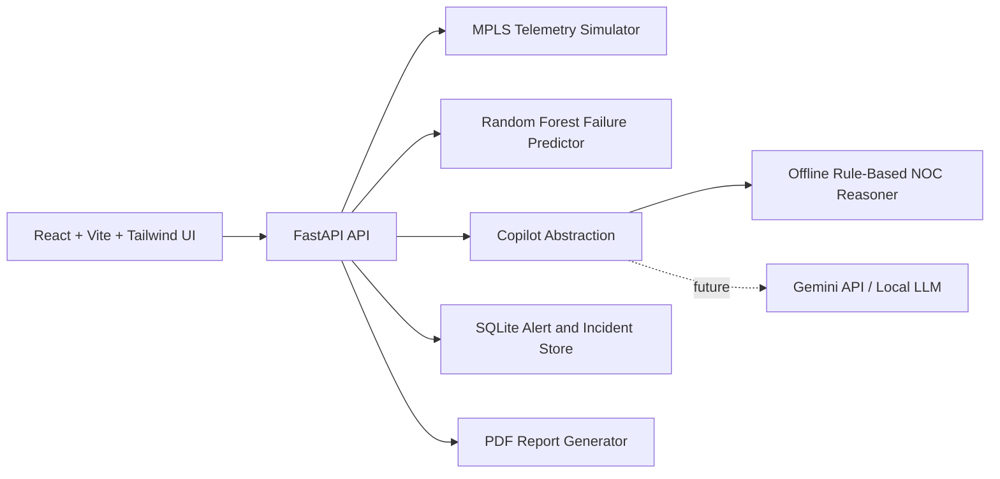

# ISRO BAH 2026: Air-Gapped Predictive Copilot for Secure MPLS Operations

Production-style hackathon MVP for simulating secure MPLS operations without access to a real network. The platform generates live router telemetry, detects anomalies, predicts failures with Random Forest, explains root causes, recommends NOC actions, and provides an offline AI Copilot chat experience.

The folder is named `smart-sales-agent` to match the requested structure, but the product and code are ISRO/MPLS focused.

## Architecture



## Features

- Simulated MPLS telemetry: CPU, memory, link status, latency, packet loss, bandwidth, traffic volume, alerts, and incidents.
- Real-time dashboard cards for active, healthy, warning, and critical routers.
- Recharts telemetry charts for CPU, latency, packet loss, and traffic utilization.
- Anomaly detection for high CPU, memory leak, latency spike, packet loss surge, link failure, and congestion.
- Scikit-learn Random Forest failure prediction with risk score, critical probability, and predicted outage time.
- Root cause analysis and recommendation engine.
- ChatGPT-style offline AI Copilot with a Gemini adapter boundary for future connected setup.
- Incident timeline and downloadable PDF reports.

## Installation

### Backend

```bash
cd smart-sales-agent/backend
python -m venv .venv
.venv\Scripts\activate
pip install -r requirements.txt
copy .env.example .env
uvicorn main:app --reload --host 0.0.0.0 --port 8000
```

### Frontend

```bash
cd smart-sales-agent/frontend
npm install
npm run dev
```

Open `http://localhost:5173`.

## API Documentation

FastAPI exposes interactive docs at:

- `http://localhost:8000/docs`
- `http://localhost:8000/redoc`

Core endpoints:

| Method | Endpoint | Purpose |
| --- | --- | --- |
| GET | `/routers` | Current router health and telemetry |
| GET | `/alerts` | Recent anomaly alerts |
| GET | `/metrics` | Summary cards and telemetry trends |
| GET | `/predictions` | Random Forest failure predictions |
| POST | `/chat` | AI Copilot analysis and recommendations |
| GET | `/reports` | Available report types |
| GET | `/reports/{report_type}` | Download PDF report |

Example chat request:

```bash
curl -X POST http://localhost:8000/chat ^
  -H "Content-Type: application/json" ^
  -d "{\"message\":\"Which router is most likely to fail?\"}"
```

## Offline And Air-Gapped Design

After dependencies are installed, the MVP can run without internet access. The default AI provider is `offline`, using deterministic NOC reasoning over live simulated telemetry. The `GeminiClient` is intentionally isolated in `backend/app/ai/gemini_client.py` so judges can see how a connected setup could swap in Gemini or, later, a local LLM.

## Deployment

### Single Host Demo

1. Start backend on port `8000`.
2. Start frontend on port `5173`.
3. Use the dashboard, Copilot, and Reports screens for the demo flow.

### Offline Bundle Preparation

1. Pre-download Python wheels for `backend/requirements.txt`.
2. Run `npm install` once and preserve `frontend/node_modules` or use an internal npm registry mirror.
3. Copy the full folder to the air-gapped machine.
4. Start the backend and frontend commands above.

## Hackathon Demo Script

1. Show the live dashboard and router table.
2. Point out warning and critical routers changing every few seconds.
3. Open the predictive failure panel and explain risk score, failure probability, and outage ETA.
4. Ask the Copilot: `Which router is most likely to fail?`
5. Ask: `What should I do about packet loss?`
6. Download the PDF incident report for NOC handover.

## Tests

```bash
cd smart-sales-agent/backend
pytest
```
